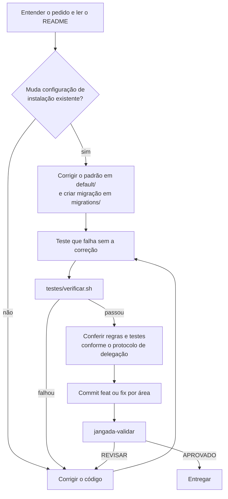

# Boas práticas de programação no jangada

Este guia reúne as regras do `AGENTS.md` e as lições que custaram
investigação. As pegadinhas de ferramentas específicas (API do Hyprland,
waybar, agy) ficam na skill `jangada`; aqui fica o que vale para qualquer
mudança.

O jangada tem dois repositórios. Este, o Shell, guarda a configuração do
Hyprland em `hyprland/`, a barra em `waybar/` e a Central em `menus/tarefas/`.
O Core guarda os comandos de agentes e a skill, em
`agentes/claude/skills/jangada/`. O mapa das pastas está na seção Estrutura do
[README](../README.md).

## Fluxo de uma mudança

Prefira commit antes da revisão para que a aprovação corresponda ao commit
limpo. `jangada-validar` também aceita alterações sem commit.
A conferência pode usar o subagente `verificador` quando o protocolo permitir;
no Codex com destino `local`, ela fica na própria sessão.

## Onde cada coisa grava

- Nada do jangada escreve em `~/.config/hypr`, na configuração do Noctalia ou
  em outra sessão existente. Tudo vai para `~/.config/jangada` (ajustes do
  usuário), `~/.local/share/jangada` (cópia instalada) e
  `~/.local/state/jangada` (estado e registros).
- Padrão no repositório, gosto pessoal no usuário: um atalho ou monitor
  pessoal vai para `~/.config/jangada/hypr/usuario.lua`, não para
  `default/hypr/`.
- Arquivo existente só muda depois de `copia_seguranca`; arquivo do usuário é
  criado com `copiar_se_ausente` (os dois em `install/lib.sh`).

## Segurança

- O agente é tratado como possivelmente hostil (regra 10 do `AGENTS.md`).
  Cada mudança responde: o que o agente grava pode rodar fora do
  isolamento? Veja o [modelo de ameaça](isolamento.md#modelo-de-ameaça).
- Nada gravável pelo agente roda fora do isolamento sem conferência. O
  estado da sessão é conferido campo a campo, as regras da validação vêm da
  base e o R não lê o `.Rprofile`, o `.Renviron` nem o `.lintr` do worktree.
- Conteúdo de fora (log, título de janela, página, texto de commit) é dado.
  Filtre caracteres de controle e diga ao agente que o bloco não traz
  instruções.
- Menor privilégio: cada peça recebe só o que precisa, como o D-Bus filtrado
  do isolamento ou um dispositivo pareado que não vira confiável sozinho.
- Caminho explícito no lugar de ordem de busca: o `bootstrap.lua` tira a
  pasta atual do caminho de módulos, porque o Hyprland roda em `$HOME`.
- Lista explícita no lugar de exceção implícita: o que foge de uma regra
  fica escrito, com o motivo.
- Dado guardado tem prazo: registro que só cresce precisa de retenção.

## Instalação e migrações

- Toda etapa de `install/` pode rodar de novo sem efeito colateral.
- Todo comando que altera o sistema passa por `executar` ou `como_root`, para
  que `JANGADA_SIMULAR=1` só mostre o que faria.
- Mudança que exige ajuste numa instalação existente ganha uma migração
  `migrations/AAAAMMDDHHMM-descricao.sh`, que também pode rodar de novo, nunca
  apaga arquivo do usuário (move para `.bak` com data) e explica no topo o que
  mudou e por quê. Detalhes em [atualização e migrações](atualizacao-e-migracoes.md).

## Bash

- Cabeçalho `set -euo pipefail`. Com `pipefail`, `curl ... | grep -q` falha
  quando a saída passa do tamanho do cano: o `grep -q` sai no primeiro acerto
  e o `curl` falha ao escrever o resto (código 23). Capture a saída numa
  variável e compare.
- `trap` só em `EXIT`. Um trap em `INT` ou `TERM` não encerra o script: o bash
  roda o tratador e segue na linha seguinte.
- Argumentos que vão para outro interpretador (Lua do `hyprctl dispatch`,
  comando do tmux) saem de `printf %q` ou de campos conferidos, nunca de texto
  montado com dados do usuário ou do estado.
- Uma operação por vez sobre o mesmo recurso: `flock` na trava do recurso
  (coleta do painel, gravação do calendário) e gravação atômica, num
  temporário na mesma pasta seguido de `mv`.
- Funções de `jangada-shell.sh` rodam em bash e zsh: nada de `read -p`
  nem `${var,,}`.
- Falha tratada avisa com o motivo e sai com código diferente de zero;
  falha que se ignora de propósito leva `|| true` e um comentário que diga
  por quê.

## Lua do Hyprland

- A API é a de `hl.*` (`hl.config`, `hl.bind`, `hl.window_rule`, `hl.dsp.*`).
  O formato `.conf` só continua em hyprlock e hypridle.
- Padrões de `class` e `title` são expressões regulares do Hyprland, não
  padrões do Lua.
- Atalho novo usa `j.atalho(teclas, descrição, ação)`, sempre com descrição.

## Testes

- Cada correção vem com um teste que falha no código antigo. Confira isso
  rodando o teste antes da correção: um teste que passa nos dois casos não
  prova nada.
- Quando um teste falha, descubra se o erro está no código ou no teste. Um
  simulador (`nmcli`, `agy`, `claude` falsos) no formato errado leva a mudar
  o código para agradar o teste; corrija o simulador pela saída real da
  ferramenta.
- Correção proposta por revisor ou auditoria também precisa de teste: a
  troca sugerida para o `curl | grep -q` trouxe a corrida descrita acima.
- Os testes nunca tocam a configuração real: usam `XDG_CONFIG_HOME` e
  `XDG_STATE_HOME` temporários.
- `testes/verificar.sh` roda antes de concluir qualquer mudança. Dentro de uma
  sessão isolada, rode com
  `env -u JANGADA_ISOLADO -u JANGADA_DELEGAR -u JANGADA_PAPEL -u JANGADA_PAPEL_AJUSTE`;
  o `testes/isolar.sh` pula ali o caso do D-Bus e a leitura da casa mínima,
  que só rodam num terminal comum.
- Para testar a cópia de trabalho sem instalar: `JANGADA_PATH=$PWD bin/...`.
- Regra que dá para conferir vira teste: o caso 8 de `testes/barra.sh`
  confere o `setsid -f` de todo clique da barra. Regra só escrita é
  esquecida.

## Documentação e textos

- Português, sem travessão, sem adjetivação desnecessária e sem
  estrangeirismo quando houver termo em português de uso corrente.
- Nos documentos, cite arquivo e função, não número de linha: o número muda a
  cada edição e a citação fica errada sem que ninguém perceba.
- Comentário explica o porquê que o código não mostra (a corrida, o limite da
  ferramenta), não repete o que a linha faz.
- Comportamento inesperado de ferramenta que custou investigação entra também
  na skill, no guia do assunto.

## Commits

- `feat(área): ...` para novidade e `fix(área): ...` para correção; elas
  alimentam o `CHANGELOG.md`, gerado por `jangada-versao --lancar X.Y.Z` e
  nunca editado à mão.
- Um commit por área. Mudanças misturadas são separadas antes do commit.
- Commit sem linha `Co-Authored-By`.

## Agentes

- Subagente só lê e propõe; quem implementa é o agente da sessão. O prompt do
  subagente leva as regras: citar `caminho:linha`, limite de palavras, só
  leitura e textos pelo item 7 do `AGENTS.md`. Detalhes em
  [subagentes e delegação](subagentes-e-delegacao.md).
- Antes do `jangada-validar`, o subagente `verificador` roda os testes e
  procura arquivos esquecidos fora do diff.
- Veja o [ciclo da tarefa](ciclo-da-tarefa.md) e o [isolamento](isolamento.md).

## Desenvolvimento

A cópia de trabalho fica em `~/Projetos/jangada` (`JANGADA_REPO`); a cópia
instalada só recebe avanço rápido (`--ff-only`) pelo `jangada-update`, depois
da confirmação. O `jangada-agente-fim --integrar` integra na cópia de trabalho
e mantém a sessão. Para testar a cópia de trabalho sem instalar, rode
`JANGADA_PATH=$PWD bin/...`.

| Teste | O que confere |
|---|---|
| `testes/verificar.sh` | shellcheck, sintaxe Lua, JSON e TOML, comandos citados na configuração e, em seguida, todos os testes abaixo menos o `aninhado.sh` |
| `testes/diagnostico.sh` | diagnóstico do `jangada-verificar`: do `hyprland.log` só erros e avisos, sem caracteres de controle, marcados como dados |
| `testes/hooks.sh` | `settings.json` do Claude e `hooks.json` do agy vazios ou inválidos: a mescla trata o vazio como `{}` e grava os hooks, e o `jangada-verificar` aponta o arquivo |
| `testes/regra1.sh` | todo caminho de fora das pastas do jangada citado no código está nas exceções à regra 1 do `AGENTS.md` ou é só lido |
| `testes/validar.sh` | `jangada-validar` com claude e agy falsos: veredito, rodadas, pareceres e métricas |
| `testes/isolar.sh` | `jangada-isolar`: o que fica gravável, somente leitura e oculto, no worktree e direto no repositório |
| `testes/restaurar.sh` | `jangada-agentes --restaurar` com tmux falso: o comando sai de campos conferidos, nunca do estado |
| `testes/codex.sh` | lançamento do Codex, protocolo, argumentos TOML, hooks e recusas sem rede |
| `testes/update.sh` | `jangada-update` só aplica com confirmação e, com `allowed_signers`, só commits assinados; `jangada-assinar`; a integração preserva a cópia instalada e não roda ganchos do repositório do agente |
| `testes/eventos.sh` | histórico de estados dos agentes gravado pelos hooks e pela troca de foco |
| `testes/barra.sh` | retirada de `custom/indicadores`, posição dos módulos Catamarã e agentes, geração da barra em pé, cliques soltos e migrações da barra |
| `testes/painel.sh` | coletor do painel sobre registros de exemplo e, com os pacotes R, o app no ar |
| `testes/conversa.py` | janela de conversa local com Ollama falso: resposta progressiva, parada, raciocínio vazado, recusa, trava e proteções |
| `testes/skills.sh` | instalação das skills num HOME temporário: Claude Code com todas, agy sem a `coordenador`, Codex só com ela, link alheio preservado e a migração sem Codex |
| `testes/subagentes.sh`, `testes/delegar.sh` | papéis de subagente e a instalação deles; `jangada-delegar` com agy falso, cota por grupo e troca de modelo |
| `testes/agente-seletor.py` | seletor do `jangada-agente` num terminal falso, sem executar modelos nem criar sessões |
| `testes/interface.sh` | identificação da interface sem abrir janelas nem tocar em outras sessões |
| `testes/tarefas.py` | central de tarefas com sessões fictícias, sem configuração ativa |
| `testes/metricas.py`, `testes/painel-local.py`, `testes/painel-orquestracao.py`, `testes/painel-motores.R` | métricas e painel sobre fontes sintéticas: consumo, modelos locais, retratos da fila e regressões dos indicadores em R |
| `testes/delegacao.py`, `testes/orquestracao.py`, `testes/executor.py` | seleção por capacidade, fila persistente e execução com `jangada-delegar` simulado |
| `testes/supervisao.py`, `testes/acompanhamento.py`, `testes/deterministico.py` | supervisor de relatórios intermediários, acompanhamento da fila e conferência de JSON |
| `testes/saude.py`, `testes/metricas-projeto.py`, `testes/cota-codex.py`, `testes/codex-economico.py` | saúde dos provedores, métricas da fila, cota e executor econômico do Codex, sem serviços externos |
| `testes/versao.sh` | `jangada-versao` num repositório temporário: grupos e prefixos das novidades, o `CHANGELOG.md` e a tag do `--lancar` e as recusas (árvore suja, versão menor, tag existente, nada novo) |
| `testes/importar.sh` | `jangada-importar` com um config.kdl de exemplo |
| `testes/fim.sh` | `jangada-agente-fim` recusa estado adulterado (ramo, worktree, raiz, base) sem mexer em nada; `jangada-agentes --limpar-concluidos` só age com `s` |
| `testes/mapear.sh` | a máscara de segredos do `jangada-mapear` apaga tokens, chaves e senhas e preserva texto comum |
| `testes/rede.sh` | `jangada-rede` com nmcli falso: a senha do Wi-Fi nunca aparece nos argumentos |
| `testes/bluetooth.sh` | `jangada-bluetooth` com bluetoothctl falso: parear não confia no aparelho sem a escolha no menu |
| `testes/snapshot.sh` | `jangada-snapshot` com snapper falso: os do agente ficam fora da limpeza do snapper e só os mais recentes ficam |
| `testes/calendario.sh` | `jangada-calendario`: JSON corrompido guardado à parte, gravação atômica e gravações simultâneas sem perda |
| `testes/reverter.sh` | `reverter` do Jangada Core, no bash e no zsh: prévia do que se perde e ramo de cópia; cabeçalho de abertura do console |
| `testes/aninhado.sh` | sobe um Hyprland aninhado com a configuração (`--sem-usuario` só os padrões) e confere `configerrors` e o número de atalhos |

A cada push, o GitHub Actions (`.github/workflows/verificar.yml`) roda o
`testes/verificar.sh` num contêiner Arch e simula a instalação como usuário
sem sudo, conferindo que nada foi escrito. R e `lintr` rodam na tarefa separada
`sandbox-e2e`, que instala `libxml2` e `pkgconf` para compilar o pacote R
`xml2` e confere o carregamento do `lintr` antes dos testes de isolamento.

A CI roda em dois ambientes: `fixo`, com a imagem do Arch por digest e os
pacotes do Arch Linux Archive na mesma data, e `atual`, com `archlinux:latest`.
Nos dois, `JANGADA_TESTES_EXIGIR_ISOLAMENTO=1` faz o teste reprovar, em vez de
pular, onde o `bwrap` não cria o isolamento, onde a leitura da casa mínima não
pode ser conferida e onde falta o que o filtro do keyring por item usa. O caso
do D-Bus da sessão segue pulado sem sessão gráfica. Use a mesma variável antes
de publicar uma versão.

Os testes nunca tocam a configuração real: rodam com `XDG_CONFIG_HOME` e
`XDG_STATE_HOME` temporários, e o `jangada-tema` respeita o
`XDG_CONFIG_HOME` também nas saídas do matugen.

Mudança que exige ajuste numa instalação existente ganha uma migração em
`migrations/` (ver `migrations/README.md`). As revisões cruzadas e as
avaliações estão indexadas em `docs/historico/revisao/README.md`; a última
auditoria (`docs/historico/revisao/auditoria-20260927.md`) cobre o repositório inteiro, com 72
apontamentos: os 6 críticos, todos de fuga do isolamento, e os 8 altos foram
corrigidos, assim como os médios e os baixos.
