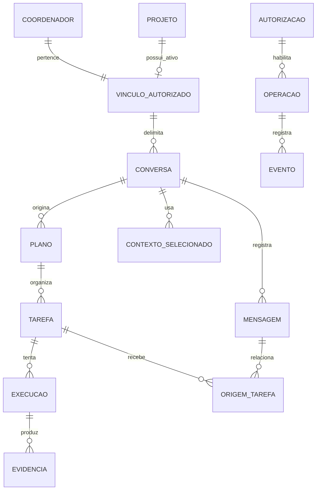
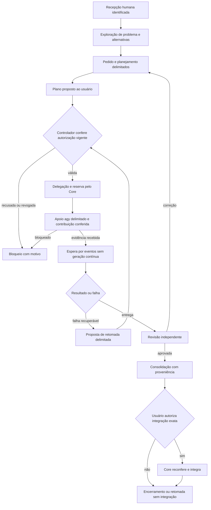

# 02. Coordenador, identidade e contextos

Coordenador é o responsável por ajudar o dono a definir o trabalho e acompanhar sua realização em um projeto.
O alvo inicial tem um coordenador por projeto, com identidade estável e várias conversas/tarefas.
Essa identidade pertence conceitualmente ao Core, mas a interação pode continuar na sessão atual e na skill existente.
Não é necessário transformar o coordenador em novo serviço ou substituir conversas do cliente para melhorar seu comportamento.

O modelo propõe; o controlador confere e executa operações autorizadas.
Preservam-se comandos, sessões, isolamento, revisão independente e confirmação humana atuais.
Os esquemas abaixo descrevem vínculos e invariantes, sem impor banco novo ou migração.
A base reutilizável está no [01](01-diagnostico.md), especialmente A6 a A16 e A20.
Múltiplos coordenadores no mesmo projeto ficam separados como evolução futura.

## Responsabilidades e fronteira de autoridade

| Participante | Responsabilidade | Autoridade |
|---|---|---|
| Usuário | Define objetivo, escopo, limites e decisões de autorização | Pode aprovar, revogar e decidir integração por gesto identificado |
| Modelo do coordenador | Explora problema e alternativas, examina contexto permitido e propõe plano, prioridades, modelos e respostas a eventos | Produz propostas, sem escrever decisões autoritativas |
| Controlador do Core | Confere identidade, política, autorização, versão, recursos, orçamento e independência | Executa os contratos aprovados e preserva evidências |
| Executor e apoio agy | Trabalham em subtarefas delimitadas e entregam artefatos com evidências | Permissões delimitadas daquela execução |
| Revisor independente | Avalia entrega exata, critérios e evidências | Produz parecer; não ganha autorização para integrar |
| Shell | Mostra estado e recolhe gestos humanos | Envia solicitações ao Core, sem regra paralela de execução |
| Monitor | Consulta histórico e medidas derivadas | Leitura conforme contrato, sem comandar execução |

O coordenador começa entendendo problema e resultado, inclusive quando o dono ainda não definiu uma solução.
Depois constrói alternativas e um pedido executável; tarefas trazem critérios, dependências e prioridades.
Recomenda candidatos de modelo explicando competência examinada, disponibilidade, custo conhecido, privacidade e conectividade.
Depois da autorização, solicita delegação ao Core e acompanha os eventos das execuções.
Seleciona uma subtarefa útil para apoio agy, exige evidências, confere a contribuição e registra seu aproveitamento ou bloqueio.
Perfil configurado não comprova participação, e agy não substitui o revisor independente.
Identifica falhas e bloqueios, pede revisão, consolida resultados e registra proveniência.

Não altera permissões, ignora limites, acessa conversa alheia ou envia fontes para fora da política.
Não aprova a própria entrega quando independência é exigida, integra sem gesto autorizado nem substitui decisão de outro coordenador.
Uma saída convincente do modelo não comprova autorização.

A skill atual descreve a coordenação numa sessão externa ao executor, em `core/agentes/claude/skills/coordenador/SKILL.md:11`.
Preservar essa interação não concede ao modelo autorização permanente para ações no host.
Ações continuam sujeitas à aprovação técnica exigida pelo ambiente e à decisão do dono sobre seu objeto.
O controlador deve executar código confiável, independente da árvore gravável do executor.
Sua autoridade fica fora do processo do modelo e não é transferida por variável, campo de JSON ou instrução textual.
Os mecanismos existentes de `confianca.py` e isolamento continuam sendo limites mínimos, não atalhos para privilegiar o coordenador.

## Entidades, identidade e cardinalidades

Identificadores são estáveis e distintos de nomes, caminhos e nomes de provedor.
Renomear coordenador ou reassociar projeto não altera vínculos históricos.
O vínculo projeto/coordenador guarda a autorização aplicável; cadastro de entidade não concede acesso por si só.

| Entidade | Conteúdo conceitual e invariantes |
|---|---|
| Projeto | ID, nome, raiz atual e anteriores, políticas e versão; identidade não reduzida ao nome da pasta |
| Coordenador | ID, nome/função, configuração de modelo/provedor versionada, estado, limites e histórico de decisões/delegações |
| Vínculo autorizado | Um coordenador e um projeto, permissões, restrições de leitura/escrita/envio, orçamento e versão da concessão |
| Conversa | Um coordenador e um projeto explícitos e imutáveis; título, estado, retenção, rascunho e anexos vinculados |
| Mensagem | ID, conversa, projeto, coordenador, emissor e tipo, ordem, origem, pedido associado e versão do conteúdo |
| Plano | Objetivo identificado, coordenador/projeto, origem humana, versão, tarefas, critérios, dependências, prioridades e situação da autorização |
| Tarefa | ID independente, projeto e coordenador responsável, versão do plano, critérios, entradas/saídas e escopo aprovado |
| Execução | Uma tarefa, uma tentativa, executor/modelo efetivos, versão de código/política, reserva, consumo e resultado |
| Autorização | ID, ator humano, operação/escopo, versão e resumo criptográfico do conteúdo, limites, validade, revogação e prova do gesto |
| Operação/evento | ID repetível, pedido causador, autorização, identidade verificada, sequência, resultado, versão e data |
| Contexto selecionado | Destinatário, finalidade, objetos e trechos incluídos, versões/resumos, permissões conferidas, política e modelo efetivo |
| Evidência | Artefato/parecer íntegro, origem e versão, critérios e localização preservada; distinta da cópia derivada de apresentação |
| Transferência futura entre coordenadores | Origem/destino, projeto/tarefa, resumo selecionado, artefatos, referências, autorização e recibo de recebimento |

No primeiro aceite, cada projeto configurado tem exatamente um coordenador ativo.
Cada identidade ativa pertence a um projeto; trocar provedor não cria outra identidade.
Um projeto ainda não configurado pode ter zero coordenadores, sem perder as sessões de tarefa existentes.
O esquema indica o vínculo ativo; histórico de substituição autorizada não é coexistência de coordenadores.

Cada conversa pertence ao coordenador e ao projeto explícitos; mudar projeto seleciona outra conversa, não reassocia seu histórico.
Cada plano pertence a esse vínculo e tem origem identificada, mas pode ser acompanhado fora da conversa de origem.
Cada tarefa tem um responsável e várias execuções. Uma mensagem pode originar várias tarefas com registros independentes.
Várias conversas do mesmo coordenador não compartilham automaticamente seus diálogos.

Exemplo sintético inicial: Demanda_Cebrap tem o coordenador “Demanda”, com as conversas “Código” e “Pesquisa”.
Artigo_Exemplo tem outro coordenador, “Artigo”, com suas próprias conversas.
Os testes iniciais usam esses dois projetos distintos e também duas conversas do coordenador Demanda.
A identidade não se reduz a rótulo de provedor, título de janela ou nome de pasta.

Representar esses vínculos não exige centralizar imediatamente todas as mensagens dos clientes.
No reaproveitamento inicial, IDs de conversa/sessão e referências a contexto selecionado podem manter a ligação com o cliente atual.
Conteúdo de históricos nativos não é importado automaticamente; a cobertura do adaptador precisa ser examinada.
As entidades Mensagem e Contexto Selecionado estabelecem invariantes para conteúdo gerido pelo Jangada, não uma ordem de trocar armazenamento.

## Exploração antes de abrir tarefas

Exploração ajuda a construir a saída; não exige que o dono chegue com solução pronta.
O coordenador examina informações já autorizadas, identifica o que falta e questiona premissas que afetam o resultado.
Apresenta alternativas concretas, consequências e uma recomendação justificada.
Distingue fatos, hipóteses, proposta e decisões ainda necessárias.
Pergunta quando a resposta muda escopo, objetivo ou conteúdo; não transforma a exploração em questionário genérico.
Escolhas já autorizadas não recebem confirmação repetitiva.

A transição ocorre quando há objetivo e conteúdo decididos, escopo delimitado, critérios de pronto, limites e autorização para executar.
Enquanto faltar uma decisão que mude o trabalho, não abrir tarefa executora por inferência.
Uma pergunta de exploração não é pedido de aprovação de comando; autorização de planejamento não autoriza implementação.

### Proposta textual para a skill atual

Texto sugerido para uma seção anterior a “Pedido de cada tarefa” em
`core/agentes/claude/skills/coordenador/SKILL.md`, sem editar esse arquivo nesta tarefa:

> Antes de abrir tarefas, ajude o dono a construir o resultado desejado.
> Entenda o problema, examine o contexto permitido e identifique premissas que precisam ser conferidas.
> Apresente alternativas concretas e suas consequências; recomende uma opção com justificativa e explicite decisões pendentes.
> Pergunte quando a resposta altera escopo, objetivo ou conteúdo. Evite questionário genérico e confirmação repetida de escolhas autorizadas.
> Separe exploração, proposta e autorização. Explorar alternativas não autoriza implementar.
> Objetivos, conteúdo e permissões continuam com o dono.
> Ao passar para execução, registre objetivo decidido, escopo, arquivos permitidos, critérios de pronto, limites e autorização correspondente.
> Mantenha um coordenador por projeto, com conversas e tarefas identificadas. Não compartilhe históricos automaticamente.
> Para cada tarefa, escolha uma subtarefa útil e delimitada de apoio agy, conforme autorização e política de dados.
> Use `JANGADA_DELEGAR=agy` em todas as delegações, inclusive leitor e redator, com destino agy explícito no fluxo protegido.
> Não use local primeiro nem Ollama como alternativa. Preferência global não autoriza envio de dados confidenciais.
> Exija autorização das fontes e conferência de confiança, cota, acesso e permissão técnica. Exija relatório com evidências e referências.
> Confira nas fontes a contribuição que aproveitar e registre papel, pedido, resultado e como ela entrou na entrega.
> Perfil configurado não prova participação. Cota, confiança, acesso ou permissão técnica insuficientes são bloqueios a registrar e comunicar.
> Não afrouxe proteção, não use `--forcar` nem troque destino silenciosamente. Apoio agy não substitui a revisão independente.
> Ao acompanhar executores, espere eventos ou consulte o estado; não mantenha o modelo gerando continuamente.
> Revisão, integração, publicação e instalação conservam suas autorizações e portões próprios.

A skill do repositório já exige apoio agy com contribuição conferida ou bloqueio rastreável, conforme A21 do [01](01-diagnostico.md).
O texto consolida esse requisito existente com as propostas de exploração e identidade persistente.
Não elimina as conferências de escopo, revisão e integração.
Aplicá-lo ou instalá-lo exige tarefa própria. Esta proposta não autoriza iniciar delegação em tarefas futuras sem a autorização aplicável.

### Exemplos e critérios observáveis

| Situação | Comportamento esperado | Evidência observável |
|---|---|---|
| “Quero melhorar a Central” sem solução definida | Examinar uso atual; comparar melhorar navegação e integrar envio; recomendar menor mudança que resolve o problema | Alternativas, consequências, justificativa e decisões pendentes antes de pedido executável |
| Pesquisa e código em Demanda_Cebrap | Mesmo coordenador, conversas distintas; perguntar sobre recorte científico se ele muda o objetivo | Proposta técnica não escolhe conteúdo científico pelo dono nem mistura históricos |
| Escolha já autorizada: preservar sessões | Avaliar melhoria dentro do limite, sem voltar a perguntar se deve substituir tudo | Pedido mantém decisão recebida e só pergunta por lacuna material |
| Plano autorizado com apoio agy | Delimitar conferência de fontes ou cobertura, receber relatório e examinar os trechos usados | Referências verificadas e contribuição registrada, não apenas perfil com agy |
| agy sem disponibilidade/confiança/cota/permissão | Registrar recusa e avisar; manter apoio pendente | Nenhuma mudança de proteção ou troca silenciosa de destino |
| Dono escolheu alternativa, mas não execução | Produzir pedido com escopo e critérios e identificar autorização ausente | Nenhum executor iniciado por tratar recomendação como aprovação |

## Apoio agy no ciclo atual aprimorado

A responsabilidade do coordenador inclui participação concreta do agy como trabalhador de apoio.
Todas as delegações usam `JANGADA_DELEGAR=agy`, inclusive leitor/redator, sem local primeiro ou alternativa Ollama.
Preferência global não autoriza envio de dados confidenciais; conferir autorização e política das fontes a cada subtarefa.
Padrões/protocolos e cobrança de apoio já estão corrigidos no repositório local, conforme A21.
A instalação ainda não recebeu essa atualização; a verificação operacional está no [05](05-plano-incremental.md#verificação-e-limitações).
Escolher algo útil à tarefa, como leitura de fontes ou análise de cobertura, sem pedir nova entrega principal ou revisão final.
Destino explícito e fontes autorizadas delimitam o envio; capacidade documental pode usar papel leitor.
O fluxo descrito em [delegação](../subagentes-e-delegacao.md#seleção-por-capacidade) exige os parâmetros aplicáveis, perfil permitido e conferências de confiança/cota.
Não confundir decisão do dono com capacidade técnica do adaptador.

Registro mínimo: tarefa/conversa/projeto, papel, pedido, fontes, destino/modelo efetivos, autorização,
resultado ou motivo de recusa, artefato/referências e trechos aproveitados pelo autor.
A contribuição pode corrigir uma lacuna, sustentar uma escolha ou não ser adotada com motivo explícito.
O coordenador verifica o que decide a entrega, não presume que referência existente confirma conteúdo correto.
Um bloqueio não é participação efetiva: conservar a pendência e comunicar ao dono, sem declarar o critério atendido.
Esses registros aproveitam a delegação existente; não exigem nova sessão principal ou serviço.

## Estados e ciclo de vida

| Objeto | Estados propostos | Não significa |
|---|---|---|
| Coordenador | Disponível, explorando, planejando, esperando autorização, acompanhando, bloqueado, consolidando, suspenso, arquivado | Acompanhando não significa geração contínua |
| Plano | Rascunho, proposto, autorizado, em execução, revisão pendente, consolidado, encerrado, revogado | Consolidado não significa integrado |
| Tarefa | Pendente de autorização, pronta, reservada, executando, bloqueada, pausada, em revisão, concluída, falhou, cancelada | Fim de turno não significa tarefa concluída |
| Execução | Reservada, iniciada, resultado recebido, interrompida, resultado incerto, encerrada | Processo ausente não comprova sucesso |
| Conversa | Ativa, arquivada | Janela fechada não é cancelamento |

Esses nomes são conceituais. O desenvolvimento deverá mapear os estados existentes sem renomeação silenciosa de contratos.
Pausa impede novas operações dependentes; cancelamento solicita interrupção de uma operação identificada.
Revogação retira autoridade para ações futuras, sem apagar o que já aconteceu.
Suspender o coordenador conserva tarefas, evidências e aprovações pendentes.
Arquivar conversa conserva vínculos; sua retenção não determina a retenção das tarefas.

Recepção preserva ID, origem humana, destinatário e objetivo.
O plano explicita escopo, critérios, artefatos, risco, prioridades, dependências, orçamento e destinos de dados.
Eventos de falha, bloqueio, entrega, revisão e revogação despertam avaliação quando necessário.
Eventos redundantes são agrupados por regra determinística; nenhuma chamada ao modelo ocorre apenas para repetir “continua executando”.
Consolidação distingue conclusão da tarefa, aceite do plano e integração de código.

## Autorizações verificáveis

Proposta de autorização não é autorização. A interface apresenta o conteúdo exato e registra o gesto humano por canal do controlador.
O recibo não pode ser criado ou alterado pelo modelo; resumo de IA referencia a decisão, nunca a substitui.
Uma concessão ampla pode autorizar tarefas futuras somente dentro de limites explicitamente aprovados, verificáveis e versionados.
A delegação não pode ampliar o limite do coordenador que a originou.

O Core confere a interseção: política do projeto, vínculo do coordenador, escopo da conversa, autorização da operação e limites do adaptador.
Recusa sem executar quando identidade, versão ou permissão faltarem.
No primeiro aceite, preservar os canais externos atuais de aprovação e as recusas do executor isolado.
D10 define a prova exigida caso a evolução acrescente novo canal de confirmação humana.
A avaliação desse canal não pressupõe substituir aprovação no terminal ou na interface do provedor.
Recomendação: canal privado do controlador no host, oculto e inacessível ao processo do modelo e aos executores isolados.
A Shell e o terminal externos solicitam confirmação por esse canal, vinculada ao conteúdo exato e a um desafio de uso único.
O Core verifica a origem admitida e o desafio; não aceita recibo fabricado, reutilizado ou recebido pelo canal de propostas do modelo.
Comando de autorização emitido de dentro do isolamento é recusado, mesmo com os mesmos argumentos da interface humana.
Variável de ambiente, nome do emissor, parâmetro de confirmação e PID declarado não autenticam presença humana.
O modelo pode solicitar aprovação, mas não alcançar o canal que a concede.
O campo `confirmar=True` numa chamada interna não é prova autônoma de gesto humano.
A escolha de qualquer novo mecanismo permanece pendente; a prova negativa desse limite é condição antes de habilitar esse canal.
Esse desenho protege contra o agente isolado, não contra comprometimento integral da conta ou do sistema do usuário.
A confiança no projeto de um provedor também não é aprovação de todas as operações daquele projeto.

| Situação | Regra proposta |
|---|---|
| Pedido reenviado por falha de conexão | Mesmo ID e mesmo conteúdo retornam recibo/estado existente, sem segunda execução |
| Mesmo ID com conteúdo diferente | Recusa; requer nova versão e nova decisão |
| Dois pedidos parecidos com IDs diferentes | Core sinaliza possível duplicação; fusão ou execução de ambos depende da autoridade aplicável |
| Plano/fontes/destino mudam depois do aceite | Invalidar uso da autorização para o conteúdo novo e apresentar diferenças |
| Interrupção depois de autorizar, antes de iniciar | Recuperar operação pendente, reconferir revogação, validade, recursos e conteúdo antes do despacho |
| Interrupção depois de enviar ao provedor, antes do recibo | Resultado incerto; reconciliar com adaptador. Não repetir automaticamente uma chamada potencialmente aceita |
| Revogação antes do despacho | Core recusa nova execução na mesma arbitragem que faz a reserva |
| Revogação durante execução | Interromper quando adaptador permitir; registrar aceitação anterior e efeitos já ocorridos, sem prometer desfazê-los |
| Conteúdo muda durante revisão/integração | Parecer e autorização valem para versão exata; mudança exige nova conferência |

Reserva e registro de operação precisam ser atômicos em relação à revogação e orçamento.
Despacho externo não integra a transação do banco: registrar intenção, envio e confirmação permite detectar a janela incerta.
Somente adaptador com chave repetível e consulta de estado comprovadas pode permitir retomada automática nessa janela.
A segurança não depende de tentar até obter aprovação.

## Três camadas de contexto e retenção

| Camada | O que contém | Recuperação permitida |
|---|---|---|
| Conversa | Mensagens, anexos e respostas daquele diálogo | Somente para seu coordenador/projeto/conversa e política vigente |
| Operacional do coordenador | Planos, tarefas, decisões referenciadas, bloqueios e delegações | Por vínculo autorizado; fatos operacionais mínimos, sem importar diálogos de origem |
| Compartilhável do projeto | Artefatos e fatos selecionados, publicados internamente por operação autorizada | Para destinatários autorizados; ser do mesmo projeto não concede acesso universal |

Quando o Jangada forma ou entrega contexto ao cliente, o Core confere IDs e permissões antes da chamada.
Contexto recuperado pelo próprio cliente precisa de exame específico; o plano não presume que os contratos atuais já o controlem.
Cada seleção registra fontes, trechos, versões, finalidade, concessões usadas e composição enviada.
Registra conteúdo ou referência preservável conforme política; um resumo criptográfico sozinho não permite reconstruir texto apagado.
Se a retenção impedir reconstrução, a auditoria informa a limitação em vez de inventar a seleção original.
Metadados e resumos também recebem escopo de leitura; listas de título e buscas podem revelar informação privada.

Entre conversas do mesmo coordenador, o padrão permite apenas estado operacional autorizado do mesmo vínculo.
Trechos de outra conversa exigem seleção explícita de conteúdo autorizado ou concessão específica do dono para aqueles objetos.
Isso não requer mecanismo formal de transferência entre coordenadores na primeira versão.
Não há memória global automaticamente acessível, busca ampla em diálogos ou uso automático de histórico privado do provedor.
Troca de modelo exige nova verificação de destino de dados, limites e composição do contexto.

A fronteira deve existir no armazenamento, nas consultas, na busca, nos eventos e no adaptador.
O processo do modelo não monta os históricos alheios nem recebe credenciais que reabram esse acesso.
Clientes CLI que recuperam memória global precisam ser examinados e delimitados antes de servir como coordenador.
A opção `JANGADA_ISOLAR_CASA=minima` oculta partes da pasta pessoal, conforme [isolamento](../isolamento.md#casa-mínima).
Ela não comprova que o adaptador deixe de recuperar outras conversas ou memórias do próprio provedor.

Retenção de conversa atende privacidade e retomada de diálogo.
Memória operacional guarda estado necessário, com referências a decisões autenticadas.
Evidências guardam o que permite revisão e auditoria, mesmo após encerrar uma conversa.
Exclusão e compactação respeitam essas políticas e não apagam decisões para simular uma história diferente.
O dono define prazos; o plano não escolhe números sem evidências.

## Concorrência inicial e colaboração futura

Um coordenador pode acompanhar várias tarefas do mesmo projeto.
Preservar reservas da fila, limites, serialização de arquivos sobrepostos e reconferência da integração.
Esses controles continuam necessários com um único coordenador; não exigem mecanismo para arbitrar decisões de coordenadores coexistentes.
Pedidos repetidos, revogação e resultado incerto seguem as regras de autorização deste documento.
Recursos do provedor podem ser partilhados por projetos distintos; usar controles existentes e registrar limites conhecidos.
Não presumir nova reserva global de cotas onde o adaptador apenas consulta disponibilidade.

A colaboração inicial é entre coordenador, autor, apoio agy e revisor, com pedido delimitado e evidências de origem.
Artefato de apoio é dado e não ganha autoridade superior.
Transferência formal entre coordenadores, mudança de responsabilidade e arbitragem de planos concorrentes no mesmo projeto são evolução futura.

Se essa evolução for autorizada, exigir origem/destino, projeto/tarefa, finalidade, resumo selecionado, artefatos, referências e autorização.
Não enviar histórico integral automaticamente ou criar memória compartilhada por conveniência.
O Core deverá arbitrar duplicação de planos, delegações conflitantes, recursos e integração simultânea sem substituir decisões alheias.
Esses critérios permanecem registrados, mas não bloqueiam o primeiro aceite nem pedem infraestrutura antecipada.

## Continuidade e recuperação

Estado durável pertence ao Core; fechar Shell ou perder Monitor não encerra coordenadores ou tarefas.
No reinício, recuperar identidades, referências de conversa, planos, tarefas autorizadas, execuções, evidências, aprovações pendentes e integrações.
Conteúdo do diálogo depende da retenção e capacidade examinada do cliente atual; sua ausência não apaga o registro da tarefa.
Confere integridade, versões, autorização vigente, processos reais e estado do repositório.
Modelo não reconstrói autoridade a partir de memória ou de um relato “já estava aprovado”.

Resultado recebido antes da queda é reconferido; chamada aceita sem resultado fica incerta.
Integração interrompida é reconciliada com base, árvore, objetos e registros, sem descarte automático.
Aprovação pendente reaparece com a mesma versão; conteúdo alterado exige nova apresentação.

| Opção a avaliar | Benefício | Limite |
|---|---|---|
| Comandos avulsos e tmux existentes | Menor mudança inicial; úteis ao coordenador mínimo | Exigem acionamento para retomada após reinício |
| Processo do controlador supervisionado | Reconciliação e eventos sem interface aberta | Instalação, ciclo de vida, credenciais e atualização exigem projeto e autorização próprios |
| Modelo sempre em execução | Nenhum requisito exige isso | Custo, contexto e falhas de autoridade tornam inadequada a espera por geração contínua |

Recomendação inicial: preservar sessões e retomada existentes, acrescentando identificação e reconferência das lacunas demonstradas.
Avaliar supervisão do controlador somente se essa avaliação mostrar benefício necessário; modelos continuam sem geração contínua durante espera.
Escolha de serviço, protocolo de transporte e tecnologia de armazenamento permanece pendente de D1, D4 e D9.
A fase 2 precisa demonstrar continuidade sem Central e retomada manual identificada após reinício, sem exigir serviço permanente.
