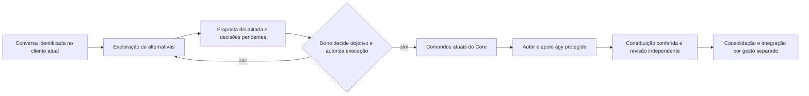
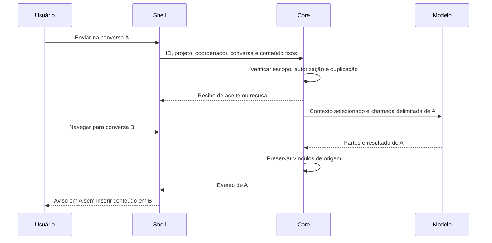

# 03. Central de Trabalho e experiência de uso

A primeira versão melhora o acompanhamento e a navegação do fluxo atual, com um coordenador por projeto e várias conversas/tarefas.
As conversas podem continuar nas sessões e clientes existentes.
Enviar mensagens dentro da Central é opção posterior, condicionada a avaliação e autorização, não requisito para substituir sessões agora.

Nenhum controle atual muda nesta tarefa. As evidências estão no [01](01-diagnostico.md), A4 a A8 e A17.
Identidade, exploração e autoridade seguem o [02](02-coordenador-contextos.md).
A visão geral compartilha estado operacional autorizado, sem juntar diálogos.

## Reaproveitamento e decisão sobre integração

| Componente existente | Melhoria para o fluxo inicial | Expansão a avaliar depois |
|---|---|---|
| Janela única, filtros e detalhes | Projeto, coordenador identificado, tarefas e acesso à sessão correta | Conversa embutida, se reduzir perda de contexto demonstrada |
| Árvore de projetos/atividades/tarefas | Distinguir coordenador, conversa referenciada, tarefa e execução | Novos registros de mensagens, sem transformar atividade em conversa |
| `QProcess`, erros, prazos e seleção | Correlação de consulta/ação e alvo explícito | Partes de respostas ligadas a chamadas persistidas |
| Prévia de integração | Preservar entrega exata e gesto humano existente | Cartões adicionais só por contrato de autorização comprovado |
| Observação e consulta periódica | Retirar dependência de arquivos internos por contratos | Eventos com cursor e recuperação de lacunas |
| Conversa local progressiva | Manter aplicativo existente e explicar seu limite de persistência | Reusar renderização se houver decisão de integrar envio controlado pelo Core |
| Modo simulado | Ensaiar dois projetos com um coordenador cada e várias conversas | Ensaios de envio integrado e, futuramente, coordenadores coexistentes |

Avaliar três opções: manter abertura da sessão atual, melhorar navegação e referências, ou integrar o envio de mensagens.
Recomendação inicial: melhorar navegação e referências, preservando os clientes e os comandos que executam trabalho hoje.
Integração só se justifica por benefício observado, como reduzir destinos errados ou facilitar retomada, sem enfraquecer limites.
Protótipo sintético e avaliação de uso devem comparar teclado, janelas estreitas, mudança de conversa e respostas atrasadas.
Não há decisão de substituir a Central Qt nem de instalar serviço conversacional.

## Navegação do primeiro aceite

```text
Central de Trabalho
  Visão geral: tarefas, bloqueios, apoio agy e revisões pendentes
  Projetos
    Demanda_Cebrap
      Coordenador Demanda
        Conversa: código -> abrir sessão identificada
          Tarefas relacionadas: ajuste A, teste B
        Conversa: pesquisa -> abrir sessão identificada
          Tarefas relacionadas: fontes C, síntese D
    Artigo_Exemplo
      Coordenador Artigo
        Conversa: métodos -> abrir sessão identificada
  Histórico e indicadores: consulta opcional do Monitor
```

Projeto -> Coordenador -> Conversa -> tarefas relacionadas é o percurso conceitual, mesmo quando conversa é um acesso ao cliente atual.
Uma tarefa mantém registro próprio, pode ter várias tentativas e ser acompanhada sem abrir o diálogo de origem.
Uma mensagem pode originar várias tarefas; vínculo não autoriza copiar o histórico inteiro.
Com um coordenador por projeto, o nome identifica o responsável, sem seletor de coordenadores coexistentes.
Projetos distintos têm identidades e contextos distintos, ainda que usem o mesmo provedor.

```text
Projeto: Demanda_Cebrap | Coordenador: Demanda | Conversa: código
Modelo/provedor efetivos quando conhecidos | Estado: exploração

Objetivo: a construir com o dono
Alternativas e consequências: referências da conversa
Decisões pendentes: escopo e conteúdo
Tarefas: registros independentes
Apoio agy: resultado conferido ou bloqueio explícito
[Conversar na sessão identificada] [Acompanhar tarefas] [Conferir entrega]
```

Cores e ícones complementam nomes; não substituem destinatário e estado textuais.
Distinguir mensagens humanas, coordenador, executores e eventos automáticos onde houver apresentação de conteúdo.
O registro operacional de apoio agy não é mensagem do dono nem autorização.
Modelo configurado e efetivamente usado são diferentes se houver troca autorizada; ausência de medida continua desconhecida.
Visão geral não tem campo de mensagem com destino implícito.

## Explorar, propor e autorizar no fluxo atual

Na conversa com o coordenador, “Quero melhorar X” começa pela exploração do problema e das saídas possíveis.
Mostrar alternativas, consequências, recomendação justificada e decisões necessárias, sem exigir uma solução pronta.
Perguntas limitam-se às lacunas que alteram escopo, objetivo ou conteúdo; decisões já recebidas não são reabertas por rotina.



Exploração, proposta de plano, autorização de execução e integração aparecem como passos distintos.
O plano traz objetivo decidido, arquivos/escopo, critérios, dependências, prioridades, candidatos de modelo, destino de dados e limites.
O texto da conversa referencia a decisão; não cria autorização por declarar “o dono aprovou”.
O Core conserva suas conferências e os canais externos atuais de aprovação.
Novo botão de autorização só pode entrar após prova de D10, não como atalho visual para aprovar comandos do modelo.

O coordenador escolhe uma subtarefa útil de apoio agy e exige relatório com referências.
Toda delegação usa `JANGADA_DELEGAR=agy`, inclusive leitura/redação; a interface não oferece local primeiro nem troca para Ollama.
A preferência global não dispensa autorização para enviar fontes confidenciais.
O repositório já contém os padrões agy corrigidos, conforme A21 do [01](01-diagnostico.md).
A interface distingue a versão instalada da versão do repositório; padrão corrigido não comprova chamada efetiva.
A Central pode apresentar o vínculo da contribuição e seu bloqueio, sem comandar envio por lógica própria.
Cota, confiança, acesso ou permissão insuficientes aparecem como pendência de apoio.
Não mostrar “agy participou” a partir do perfil configurado; resultado efetivo e uso conferido precisam existir.
O revisor permanece independente: nesta tarefa, Claude.

## Navegação, rascunhos e respostas nas sessões atuais

Abrir outra conversa pela Central não deve digitar, transferir anexos ou mudar destino da mensagem em preparo no cliente anterior.
Toda abertura precisa identificar projeto, coordenador e conversa/sessão de destino.
Não prometer persistência ou preservação de rascunho do cliente que ainda não foi examinada.
A avaliação inicial testa o comportamento dos clientes permitidos e registra limites antes de oferecer retomada automática.
A conversa local existente guarda contexto em memória e aborta sua chamada ao fechar; A8 registra esse fato.

| Situação inicial | Invariante e avaliação |
|---|---|
| Navegar para outra tarefa/projeto | Somente mudar seleção ou abrir sessão identificada; não reenviar texto pendente |
| Resposta na sessão não selecionada | Permanece na conversa de origem; aviso operacional não inclui diálogo em outro projeto |
| Rascunho/anexo no cliente atual | Fica no cliente/conversa original; não acompanha navegação da Central |
| Retomar após fechar Central | Reconferir sessão e estado; Central fechada não cancela tarefa |
| Cliente não preserva rascunho/posição | Informar limite e decidir melhoria necessária; não afirmar suporte inexistente |
| Uma conversa do mesmo coordenador usa resultado de outra | Seleção explícita de artefato autorizado, sem recuperação automática do diálogo |

A melhoria de navegação não exige extração de históricos privados nem armazenamento global de conversas.
Busca e visões agregadas mostram somente metadados autorizados; títulos também podem revelar informação privada.

## Opção posterior: envio integrado à Central

Somente se D8 escolher integração, aplicar os contratos abaixo.
Eles preservam o desenho anterior como opção, sem torná-lo bloqueador do primeiro aceite.



O campo de mensagem identifica textualmente coordenador, projeto e conversa.
No envio, congelar conteúdo e anexos da versão enviada; mudança de navegação não altera destino.
Limpar apenas a versão do rascunho aceita pelo Core, sem apagar texto digitado depois.
Recusa conserva texto e anexos. Conexão perdida exige consultar recibo pelo ID antes de reenviar.
Resposta tardia continua vinculada à chamada original; trecho parcial não é entrega aprovada.

| Operação integrada, se aprovada | Comportamento obrigatório |
|---|---|
| Trocar conversa | Salvar rascunho, anexos e posição por conversa; carregar somente os do destino |
| Resposta assíncrona chega | Vincular à chamada/conversa original, sem mover foco ou destino atual |
| Fechar e reabrir interface | Recuperar estado de apresentação segundo retenção, sem cancelar tarefa |
| Modelo/destino de dados muda | Nova verificação de política e contexto antes da chamada seguinte |
| Anexo muda depois de selecionado | Recusar versão alterada; nova seleção/aceite explícitos |
| Core indisponível | Manter rascunho e estado anterior marcado como desatualizado; não simular aceite |

Persistência e seleção de contexto ficam no Core, não no widget.
Renderização progressiva da conversa local pode ser reaproveitada; sua chamada direta ao Ollama não vira autoridade de execução.
“Parar resposta”, “Pausar tarefa”, “Cancelar execução” e “Revogar autorização” têm alvos e efeitos distintos.

## Acompanhamento, revisão e retomada

No primeiro aceite, conservar acompanhamento por eventos/consultas e acesso ao terminal para operações já existentes.
Mostrar tarefa, execução, última evidência, bloqueio, próximo passo autorizado e apoio agy conferido ou pendente.
O coordenador não precisa gerar continuamente para manter estado atualizado.

Conferir entrega mostra autor, revisor, objeto exato, critérios, evidências e limitações.
Conferência determinística, apoio agy e amostragem não substituem revisão independente final.
Prévia de integração e gesto humano continuam separados; Core reconfere base/candidato/revisão e concorrência.
Base alterada ou parecer antigo impede integração. Fim de turno, integração e encerramento de sessão são estados diferentes.

Fechar Central não cancela tarefas. Após reinício, reconferir processos reais, registros e artefatos antes de retomar.
Resultado incerto não permite repetir integração ou descartar trabalho automaticamente.
Monitor indisponível deixa indicadores ausentes, sem impedir execução.
Aprovações pendentes reaparecem como referências ao mesmo objeto/versão, não como novo aceite.

## Evolução futura: vários coordenadores no mesmo projeto

Somente após decisão separada, avaliar seletor de coordenador, transferências com origem/destino e arbitragem de planos concorrentes.
A prévia de transferência deverá listar resumo, artefatos, referências, destino de dados e autorização, sem histórico integral por padrão.
Esses controles não aparecem como requisito de navegação ou aceite inicial.
A integração futura não pode conceder privilégios adicionais por reorganização da interface.
