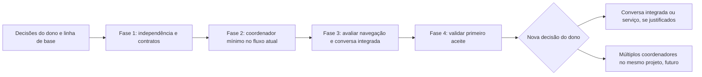

# 05. Plano incremental, marcos e aceite

O primeiro aceite preserva e aprimora o fluxo atual: um coordenador por projeto, várias conversas/tarefas e apoio agy efetivo.
Explorar problema e alternativas precede abrir tarefas executoras.
Contratos, identidade e isolamento evoluem sem pressupor novo serviço ou envio integrado na Central.

Múltiplos coordenadores no mesmo projeto, transferências e arbitragem entre eles ficam para evolução futura.
Dois coordenadores nos ensaios iniciais pertencem a dois projetos distintos.
Todos os marcos abaixo são propostas para tarefas futuras, não autorização de implementação nesta entrega.

O [01](01-diagnostico.md) preserva o diagnóstico; o [02](02-coordenador-contextos.md) traz definição, contexto e proposta textual da skill.
O [03](03-central-ux.md) separa navegação inicial de envio integrado opcional.
O [04](04-gas-town-riscos.md) mantém riscos e limites da referência oficial.

## Contratos necessários ao fluxo atual

Complementar os [contratos K1 a K10 da modularização](../modularizacao-3.0/03-contratos.md), sem alterá-los nesta tarefa.
K1 preserva a fachada pública dos comandos, suas opções, códigos de saída e formatos; K2 preserva os caminhos legados por links relativos versionados.
Melhorar uma prática da skill não exige implantar todas as superfícies novas antes de seu uso.
Nova operação que mude estado, alcance ou autoridade exige contrato e prova próprios antes de habilitação.

| Superfície | Necessário ao aprimoramento inicial | Ampliação condicionada |
|---|---|---|
| Comandos | Preservar fachada, escopo, aprovação técnica e alvos; ID de operação onde houver repetição | Novo canal tipado de propostas do modelo, se aprovado |
| Consultas | Completar dados públicos, filtrar escopo e retirar leitura interna da Central | Paginação/cursor conforme volume medido |
| Eventos | Vínculos tarefa/execução, acompanhamento e recusa visíveis sem geração contínua | Canal com sequência retomável se consumidor novo precisar |
| Autorizações | Preservar canais externos e prova da decisão sobre objeto exato; texto não autoriza | D10: autenticar qualquer novo botão/canal inacessível ao executor |
| Adaptadores | Examinar limites reais de sessão, leitura de contexto, delegação e revisão | Envio integrado só depois de avaliar o cliente atual |
| Evidências | Proveniência de plano/tarefa/execução, apoio agy, revisão e objeto aprovado | Contexto selecionado de mensagens armazenadas pelo Core, se essa persistência for escolhida |
| Compatibilidade | Registrar versões e recusar mudança incompatível de sessões ativas | Coexistência de versões, se necessária e demonstrada |

Modelo coordenador não ganha autoridade de controlador por nome ou reorganização.
Core deve funcionar sem Shell/Monitor. Monitor ausente não impede execução.
Consultas e indicadores não podem limpar, autorizar ou executar como efeito de leitura.
Conteúdo de outra conversa ou projeto não é recuperado automaticamente.
Escolher transporte e armazenamento mínimos só após examinar lacunas do fluxo atual.

Atualização não pode trocar silenciosamente código ou políticas de sessões ativas.
Avaliar conjunto de código identificado por versão e compatibilidade dos registros.
Sem coexistência comprovada, recusar atualização incompatível até encerramento autorizado; não matar trabalho para viabilizar atualização.
Migração, cópia de segurança e serviço seriam tarefas próprias, com decisão separada.

## Fases e dependências



### Fase 1: independência dos módulos e contratos

M1.1: retirar dependências obrigatórias A2/A3 e classificar recursos opcionais.
Avaliar padrão R como recurso do Core ou compartilhado neutro, sem mover o Shell inteiro.
Preservar diagnóstico do Monitor por fachada adequada; separar testes mistos sem esconder dependência real.

M1.2: consulta pública completa de sessões substitui A4; contrato de avisos/consulta substitui conhecimento interno de A5.
Examinar também leituras do shell de terminal e descoberta de bancos no Monitor.
Auditar links e configurações indiretas; busca por expressão regular sozinha não demonstra independência.

M1.3: versionamento, erros e avaliação de grande volume.
Manter K1/K2 e destacar mudanças nas pastas reais durante atualização.
Recusar incompatibilidade comprovada, sem impor serviço de distribuição de versões.

Portão: ciclo sintético do Core sem Shell/Monitor; consultas não escrevem na origem;
consumidores usam contratos; falhas e versões desconhecidas não viram estado falso.
Dependências: D1/D9 e linha de base conferida em ambiente de teste autorizado.

### Fase 2: coordenador mínimo, preservando sessões

M2.0: proposta de evolução da skill com exploração de alternativas e apoio agy.
Adotar em tarefa própria o texto do [02](02-coordenador-contextos.md#proposta-textual-para-a-skill-atual), após avaliação do dono.
Ensaiar exemplos em diálogo sintético: problema sem solução pronta, premissa duvidosa, recomendação e decisão de conteúdo pendente.
Não pedir aprovação repetida de escolha já recebida nem iniciar implementação por interpretar exploração como autorização.

M2.1: identificação persistente mínima de um coordenador por projeto e conversas/tarefas relacionadas.
Associar as sessões existentes à identidade, sem trocar cliente ou importar históricos automaticamente.
Distinguir estado operacional, conversa e evidências; selecionar contexto com origem e escopo verificáveis.
Examinar isolamento do adaptador entre dois projetos e entre conversas do mesmo coordenador.
Se o cliente recupera memória global sem controle, registrar lacuna e não declarar isolamento atendido.

M2.2: passagem de exploração a pedido executável, com critérios, dependências, prioridades, modelos examinados e autorização.
Preservar revisão e integração atuais. Repetição, mudança de conteúdo, revogação e despacho incerto têm regras explícitas.
O canal de autorização não aceita comando emitido pelo executor isolado.
D10 rege qualquer canal novo; o coordenador mínimo não depende de acrescentar botão de aprovação ou serviço.

M2.3: apoio agy protegido e acompanhamento.
A decisão do dono é `JANGADA_DELEGAR=agy` para todas as delegações, inclusive leitor/redator, sem local primeiro ou alternativa Ollama.
A correção dos padrões/protocolos pertence a `delegacao-agy-padrao`, tarefa separada; esta sessão só documenta a dependência.
Seu resultado deverá ser conferido antes de declarar a política efetiva nos clientes e perfis, sem editar esses arquivos aqui.
Preferência global não autoriza enviar fontes confidenciais.
Escolher subtarefa útil, registrar fontes/destino e exigir relatório com evidências; autor confere a contribuição adotada.
Perfil com agy não comprova chamada ou trabalho efetivo.
Bloqueio de cota, confiança, acesso ou permissão mantém apoio pendente, com aviso; sem troca silenciosa ou proteção afrouxada.
Delegação não transforma fila documental em executor geral nem substitui revisão independente.
Acompanhamento reutiliza eventos/consultas e não mantém geração contínua do coordenador.

M2.4: continuidade, retomada e concorrência de tarefas.
Reusar tmux, registros, reservas, controles de orçamento e integração; reconciliar execução real antes de retomar.
Retomada manual identificada após reinício é aceitável no primeiro recorte.
Avaliar processo supervisionado apenas se houver lacuna operacional demonstrada que exija isso.
Preservar serialização de tarefas que editam os mesmos arquivos e as conferências de integração já existentes.
Não construir arbitragem entre coordenadores coexistentes no mesmo projeto.

Portão: um coordenador em cada um de dois projetos distintos; várias conversas/tarefas em um deles;
nenhum acesso cruzado automático; autoria, apoio agy efetivo ou bloqueio e revisão registrados sem elevar autoridade do modelo.
Bloqueio de apoio é limitação, não critério de participação atendido.
Dependências: contratos aplicáveis de M1, D2/D3/D5/D6/D10/D11 e exame do adaptador.
M2.0 pode ser ensaiado antes das mudanças estruturais, pois melhora comportamento sem nova infraestrutura.

### Fase 3: avaliar navegação e conversa na Central

M3.1: protótipo sintético para Projeto -> Coordenador -> Conversa -> tarefas relacionadas.
Melhorar seleção textual e abertura da sessão correta, preservando clientes e acesso à fila.
Testar dois projetos distintos e rascunhos/destinatários no cliente atual, sem presumir suporte não examinado.

M3.2: comparar manter acesso externo, melhorar referências e integrar envio.
Registrar benefícios, limites, desempenho e manutenção de cada opção.
D8 decide se a integração resolve problema demonstrado; ausência de conversa embutida não reprova o primeiro aceite.
A conversa local em memória não deve ser apresentada como persistente.

M3.3: melhorar apresentação de exploração/proposta, apoio agy, bloqueios, revisão e retomada por contratos existentes.
Não adicionar segunda coordenação ou execução na interface.
Cartões novos de autorização dependem de D10 e não são requisito para conservar os gestos atuais.

Portão: navegação não transfere mensagem/anexo nem resposta em andamento;
projeto/coordenador/conversa/tarefa distinguíveis; abrir/fechar Central conserva tarefas e destinos.
Dependências: M2 e D8 para eventual expansão; nenhum desenho visual corrige isolamento pendente.

### Fase 4: validação integral do primeiro aceite e portão de evolução

M4.1: validar ciclo completo com um coordenador por projeto, sessões existentes, apoio agy e revisão independente.
Incluir reinício, falhas, consulta volumosa, versão incompatível e concorrência de tarefas do mesmo coordenador.
Core sem Shell/Monitor e indicadores opcionais continuam condições de aceite.

M4.2: consolidar limitações e avaliar expansões sem aplicá-las.
Conversa integrada e serviço supervisionado precisam de benefício comprovado, contratos e autorização separados.
Múltiplos coordenadores no mesmo projeto requerem nova decisão, nova análise de isolamento e critérios futuros próprios.
Não implementar infraestrutura dessas expansões para declarar M4.1 concluído.

Portão: matriz inicial abaixo atendida no ambiente autorizado, revisão independente e decisão humana antes de integrar ou disponibilizar implementação futura.
Dependências: fases 1/2 e melhorias escolhidas de M3. Os testes conceituais não substituem provas de implementação.

## Matriz de aceite inicial

Cenários são propostas de testes, não testes escritos nesta tarefa.
Usar fontes, conversas, projetos e provedores sintéticos; operação real só com autorização posterior.

| Critério | Marco | Positivo | Negativo | Falha/recuperação |
|---|---|---|---|---|
| C1 Core sem Shell/Monitor | M1.1; M4.1 | Ciclo de execução, revisão e preparação de integração por comandos atuais | Dependência obrigatória de configuração/link externo ao Core reprova | Indicador ausente não impede resultado/revisão |
| C2 Identidade e permissões | M2.1/M2.2; M4.1 | Identidade estável por projeto, várias sessões associadas | Rótulo não concede autoridade; comando de autorização emitido do isolamento é recusado | Registro inválido bloqueia operação, sem apagar evidência |
| C3 Isolamento sem mistura | M2.1; M4.1 | Dois coordenadores em dois projetos; duas conversas do mesmo coordenador | Leitura/busca/contexto não importa conversa alheia automaticamente | Resposta atrasada permanece no projeto/conversa original |
| C4 Destinatários e rascunhos no fluxo preservado | M3.1; M4.1 | Central abre sessão identificada e não transporta texto/anexos pendentes | Seleção de projeto/tarefa não altera destino em trânsito | Limite de retenção do cliente é informado; não prometer recuperação inexistente |
| C5 Contexto autorizado | M2.1/M2.2; M4.1 | Conteúdo selecionado com escopo, origem, versão e permissão | Conversa do mesmo coordenador não libera outro diálogo | Fonte ou autorização mudou: nova conferência antes de usar |
| C6 Delegação rastreável | M2.3; M4.1 | Objetivo, autorização, subtarefa agy, relatório e uso examinados | Perfil configurado não conta como participação | Recusa registrada; sem trocar destino ou afrouxar proteção |
| C7 Continuidade sem interface | M2.4; M3.3/M4.1 | Fechar Central conserva sessões/tarefas autorizadas | Fechar conversa não cancela tarefa | Reabrir apresenta bloqueios e revisões pendentes |
| C8 Recuperação após reinício | M2.4; M4.1 | Retomada manual identificada reconcilia processo, registros e artefatos | RUNNING sozinho não comprova processo vivo ou sucesso | Queda em execução/revisão/integração conserva resultado incerto |
| C9 Revisão independente | M2.2/M2.3; M4.1 | Parecer do objeto exato por revisor admitido distinto do autor | Apoio agy, autorrevisão e parecer antigo não aprovam entrega final | Falha de Claude nesta tarefa conserva pendência, sem substituição por agy |
| C10 Colaboração atual e proveniência | M2.3; M4.1 | Autor incorpora apoio agy conferido e registra origem/autorização | Relatório recebido não autoriza operação ou histórico integral | Consumo/resultado incerto impede declarar apoio concluído |
| C11 Concorrência de tarefas e integração | M2.4; M4.1 | Um coordenador respeita recursos e tarefas de escrita sobrepostos | Integrações conflitantes não avançam juntas | Reserva expirada e Git externo exigem reconferência, sem descarte |
| C12 Consultas de grande volume | M1.3; M4.1 | Medir filtros, cópias, tempo/memória e integridade da origem | Sem medida não declarar desempenho adequado | WAL em mudança/consulta incompleta geram erro ou retrato consistente |
| C13 Distinção das entidades | M2.1; M3.1/M4.1 | Uma mensagem gera duas tarefas com tentativas próprias | Fim de turno não conclui plano/tarefa | Tarefa continua identificável depois de arquivar conversa |
| C14 Ciclo completo | M2.2/M2.3; M4.1 | Explorar -> decidir -> autorizar -> executar/apoio -> revisar -> consolidar -> integração humana | Recomendação ou conversa não autoriza execução/integração | Base muda após prévia: nova revisão/conferência, sem descarte |
| C15 Repetição, revogação e conteúdo | M2.2; M4.1 | ID/conteúdo repetido não cria segunda operação | Conteúdo alterado ou confirmação reutilizada não conserva autorização | Queda entre aceite e despacho exige reconciliação antes de repetir |
| C16 Compatibilidade | M1.3; M4.1 | Sessão conserva versão e contrato identificado | Atualização incompatível não muda sessão silenciosamente | Retomada usa versão compatível ou bloqueia com motivo |
| C17 Exploração antes da implementação | M2.0; M4.1 | Problema sem solução pronta recebe alternativas, consequências e recomendação | Não escolher objetivo/conteúdo pelo dono nem criar questionário genérico | Informação insuficiente gera pergunta material e proposta condicional, sem executar |
| C18 Apoio agy efetivo e exclusivo | M2.3; M4.1 | Evidências conferidas e contribuição utilizada ou rejeitada com justificativa | Perfil não comprova trabalho; leitor/redator não usam local primeiro; agy não substitui Claude | Indisponibilidade/cota/confiança/acesso/permissão bloqueiam apoio e são comunicados; sem Ollama |

C11 usa os controles de tarefas/recursos existentes e examina suas lacunas; não exige arbitragem de vários coordenadores no mesmo projeto.
C4 exige preservação do destino e não transferência de rascunhos durante navegação. Persistência após fechar o cliente exige capacidade examinada.
C12 mede volume e escrita concorrente antes de fixar limites aceitáveis; nenhum valor de desempenho foi inventado.

## Critérios de evoluções futuras, fora do primeiro aceite

| Evolução | Condição para avaliar | Aceite adicional |
|---|---|---|
| E1 Envio integrado à Central | D8 demonstra benefício e autoriza a opção | Rascunhos/anexos/posição persistidos por conversa, recibos repetíveis e respostas assíncronas vinculadas pelo Core |
| E2 Processo supervisionado | D4 identifica lacuna que retomada manual/sessões atuais não resolve | Reconciliação sem interface e após reinício automático, sem modelo gerando em espera |
| E3 Múltiplos coordenadores no mesmo projeto | Nova decisão explícita do dono, após primeiro aceite | Identidades coexistentes e conversas isoladas também no mesmo projeto |
| E4 Transferência entre esses coordenadores | E3 autorizado e necessidade demonstrada | Origem/destino, resumo/artefatos selecionados, referências, autorização e recebimento, sem histórico integral automático |
| E5 Arbitragem entre esses coordenadores | E3 autorizado | Planos/delegações conflitantes, duplicação, orçamento e integração simultânea sem corrupção ou substituição de decisões alheias |

E3 a E5 não justificam construir tabelas, seletores ou mecanismos adicionais na primeira versão.
E1/E2 também são opcionais: primeiro avaliar reaproveitamento e benefício ao fluxo atual.
Os critérios originais correspondentes continuam cobertos como futuro, sem inflar o aceite inicial.

## Complexidade relativa

| Frente | Complexidade e recorte | Reaproveitamento |
|---|---|---|
| Exploração e proposta textual da skill | Menor que nova infraestrutura; exige comportamento observável e decisões claras | Skill e diálogo atual; texto não precisa de serviço |
| Apoio agy com evidência | Delimitada se adaptador permitido; disponibilidade é incerteza externa | Delegação e registros existentes, sem nova sessão principal |
| Independência R/diagnóstico | Localizada, com cuidado em links e testes mistos | Core, fachada e testes atuais |
| Identidade e seleção de contexto | Intermediária a alta conforme limites do cliente | IDs de projeto/sessão e estado operacional; sem importação global presumida |
| Navegação e acompanhamento | Intermediária | Central Qt, consultas, eventos e abertura de terminal |
| Recuperação e segurança de autorização | Alta nos pontos que atravessem fronteira de autoridade | Portões atuais e evidências protegidas; reconferência antes de automatizar |
| Envio integrado ou serviço | Alta e opcional | Só avaliar após benefício medido; não bloqueia melhoria de comportamento |
| Vários coordenadores e arbitragem no mesmo projeto | Alta e futura | Não construir antecipadamente para atender primeiro aceite |

A classificação não estima prazo, pessoas, preço ou quantidade de código.
Não pressupõe reescrita do Core, troca de banco, três repositórios ou substituição integral da Central.
Implementação futura preserva fachada, dados, evidências e clientes até que uma mudança seja demonstrada e autorizada.
Reversão não restaura código antigo sobre esquema incompatível sem conferência; migração e serviço exigem tarefas próprias.

## Participação de apoio nesta tarefa documental

### Tentativa desta continuação

Em 13/10/2026, nesta worktree, o autor repetiu a conferência de cobertura por `jangada-delegar leitor`.
Usou `JANGADA_DELEGAR=agy`, `--destino agy`, `--capacidade analise_documental`, `--permitir-remoto` e `--arquivos` com os seis documentos deste conjunto e `core/agentes/claude/skills/coordenador/SKILL.md`, fontes autorizadas.
O pedido delimitou recorte inicial, conversas/tarefas, exploração, apoio exclusivo agy, revisão Claude e separação das expansões futuras.
Pediu comparação da proposta textual com a skill atual e lacunas com caminho:linha; não pediu revisão final nem edição.

Resultado desta chamada: código 4, duração de zero segundos e três linhas, conforme `jangada-filtrar`.
Recusas: “o agy não achou o agente leitor” e “nenhum executor elegível concluiu a delegação”.
Não houve relatório nem contribuição de conteúdo. O autor conferiu a saída e o requisito de papel instalado no catálogo do agy.
O bloqueio foi comunicado durante a tarefa e registrado aqui; C6/C18 continuam pendentes quanto à participação efetiva.
A investigação do papel pertence à tarefa paralela. Esta continuação não instalou agentes nem alterou confiança, cota ou proteções.
Não usou Ollama, outro destino ou nova sessão principal; a recusa não autoriza contorno.

Na retomada de 13/10/2026, após 22h38, nova chamada protegida usou essas fontes e pediu conferência das cinco correções do parecer r1.
Manteve `JANGADA_DELEGAR=agy` e os mesmos parâmetros, com `JANGADA_PATH=/home/felipinto/.local/share/jangada` para usar o fluxo instalado.
Resultado: código 4, zero segundos, três linhas e as mesmas recusas por leitor ausente; nenhum relatório foi produzido.
O autor conferiu a saída e conservou o bloqueio de C6/C18; a chamada não comprova disponibilidade do modelo.
A correção `6e7b751`, informada pelo coordenador, ainda não foi integrada nem instalada; não é capacidade instalada comprovada nesta tarefa.

## Conferência desta entrega documental

### Execução desta continuação

Os seis documentos foram importados pelo Git de `3376c94`, sobre `main` em `50ba7a0`.
Nenhum commit ou código da tarefa paralela `delegacao-agy-padrao` foi incorporado.
Registros da tarefa antiga não são evidência desta entrega.

Em 13/10/2026, nesta worktree, foi executado:

```sh
JANGADA_PATH="$PWD" jangada-filtrar -- bash testes/verificar.sh
```
Resultado: código 1, duração de 398 segundos e 6.967 linhas geradas, segundo `jangada-filtrar`.
O filtro mostrou seis erros de criação de sockets em `testes/monitoramento.py`, com `PermissionError: Operation not permitted`.
Mostrou também falha de confiança do agy em `testes/agente-seletor.py` e falhas encadeadas em `testes/validar.sh`.
Outras 2.349 ocorrências foram omitidas pelo filtro; não são uma contagem de testes falhos.
Sem examinar essa parcela, não atribuir todas as falhas ao ambiente nem declarar a suíte aprovada ou ausência de regressão.
Não houve repetição fora da proteção, alteração de testes ou configuração para obter aprovação.
A conferência externa pelo coordenador continua necessária antes de integrar.
Na retomada para corrigir r1, a suíte completa não foi repetida, conforme orientação do coordenador.

Conferência local dos documentos: destinos e âncoras dos links locais válidos; nenhum travessão encontrado.
O diff está restrito aos seis caminhos permitidos; o diagnóstico conserva versão/data e foi confrontado com os trechos citados.
As seis fontes oficiais Gas Town da tabela do [04](04-gas-town-riscos.md) estão acessíveis nesta consulta.
Esta worktree não contém `.jangada/validar.sh`; não foi copiado estado privado da raiz para acrescentar esse arquivo.
A suíte com código 1 não cumpriu a regra 6 de AGENTS.md. A verificação permanece pendente em ambiente autorizado.
O parecer de `jangada-validar` fica no registro operacional desta nova sessão e precisa corresponder à versão final completa contra `main`.
