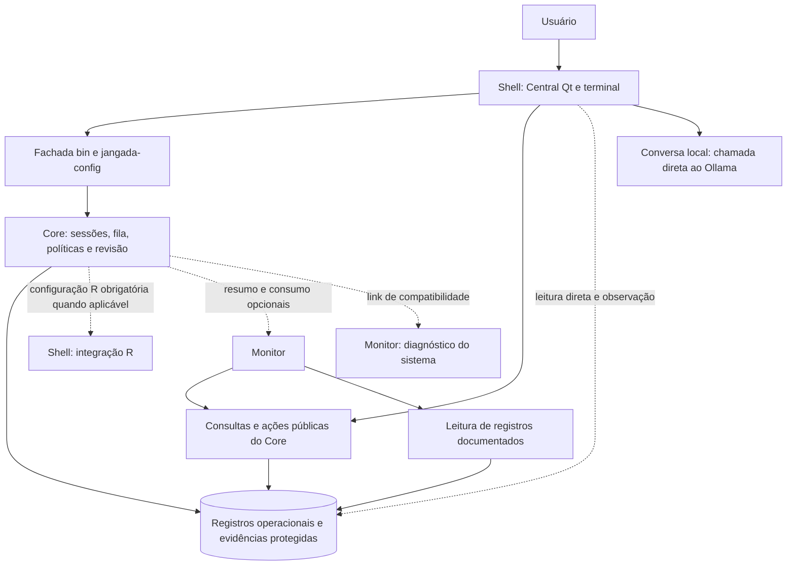

# 01. Diagnóstico da arquitetura atual

O recorte atualizado preserva o fluxo atual: um coordenador por projeto, várias conversas/tarefas e apoio agy comprovado.
A separação física em Core, Shell e Monitor existe. A independência funcional completa ainda não está demonstrada.
O campo de exibição do coordenador e a conversa local não constituem o coordenador persistente pedido.

Base: commit `6e7b751a16f51f1de9db4916ccbe92e292f125f7`, examinado em 13/10/2026.
Localizadores abaixo usam caminho real e linha inicial do trecho.
“Fato” significa comportamento identificado no código; “limitação” restringe o que ele comprova.
“Hipótese” pede medição ou ensaio futuro; “proposta” descreve mudança ainda não autorizada.

## Mapa confirmado

As setas tracejadas são acoplamentos atuais, não o desenho desejado.
A chamada direta da conversa local também precisa mudar para participar do futuro ciclo controlado.

| Dependência: linha usa coluna | Core | Shell | Monitor | Compartilhado |
|---|---|---|---|---|
| Core atual | `nucleo`, `orquestracao`, `delegacao` | Configuração R; instantâneo opcional; funções gráficas indiretas | Resumo/consumo opcionais; link de diagnóstico | Fachada, configuração, ganchos |
| Shell atual | Comandos, `nucleo.acoes`, registros e observação de arquivos | Qt, desktop e integração com terminal | Abre painel e diagnóstico | Configuração e recursos visuais |
| Monitor atual | Consultas, métricas e registros documentados; conhece localização do banco | Sem dependência obrigatória identificada nos trechos examinados | Coletor e painel R | Configuração e recursos visuais |
| Core proposto | Controle, coordenação, persistência e contratos próprios | Nenhuma obrigatória | Nenhuma obrigatória | Configuração neutra, se necessária |
| Shell proposto | Apenas contratos públicos de consulta, comando e evento | Estado de apresentação | Indicadores opcionais por contrato | Recursos visuais |
| Monitor proposto | Consultas e registros versionados, somente leitura | Nenhuma | Cópia derivada e análise derivada | Configuração neutra |

A matriz registra dependências observadas, não prova uma ausência global.
O teste futuro de remoção deve examinar arquivos de configuração e links, além de chamadas e importações.

## Evidências e lacunas

| ID | Tipo e achado | Evidência atual | Consequência |
|---|---|---|---|
| A1 | Fato: caminhos físicos e fachada legada | `bin/jangada-config:14` define `JANGADA_CORE_PY`; links `bin/jangada-agente` e `default/nucleo` chegam ao Core | Manter fachada durante evolução; mover pastas não basta |
| A2 | Fato: configuração R do Shell usada pelo Core | `core/bin/jangada-validar:790`, especialmente `:803`; `default/r` aponta para `shell/integracoes/r` | Arquivos R sem `.lintr` da base precisam desse padrão; Core não é independente neste percurso |
| A3 | Fato: link do Core chega ao Monitor | `core/nucleo/monitoramento.py` aponta para `../../monitor/painel/monitoramento.py`; `shell/bin/jangada-monitor:8` usa o caminho legado | Separar diagnóstico opcional de execução; link não prova necessidade em todo comando do Core |
| A4 | Fato: Central lê JSON de sessão diretamente | `shell/menus/tarefas/dados.py:89` abre arquivo; `:104` complementa a listagem com esses campos | Variável de caminho e leitura segura não substituem contrato de consulta |
| A5 | Fato: Central conhece estrutura interna para vigiar estado | `shell/menus/tarefas/janela.py:692` observa revisões, projetos, JSON e SQLite; `:425` agrupa avisos e consulta periodicamente | Mudança de armazenamento afeta a interface; substituir por eventos e consulta incremental |
| A6 | Fato: coordenador é declaração para exibição | `core/bin/jangada-agente:17`, `:106`, `:548`; `shell/menus/tarefas/dados.py:73`, `:116`; `janela.py:581` | Nome não autentica identidade, permissões, vínculos ou contexto |
| A7 | Fato: coordenação atual é protocolo de sessão e arquivo textual | `core/agentes/claude/skills/coordenador/SKILL.md:11`, `:98` prevê `.jangada/coordenacao.md` | Útil como prática; texto gravável não é decisão humana autenticada nem armazenamento isolado de vários coordenadores |
| A8 | Fato: conversa local guarda mensagens em memória e chama Ollama diretamente | `shell/menus/conversa/janela.py:54`, `:181`, `:229`, `:258`, `:264` | Há contexto durante a janela; não há persistência própria identificada. Fechar aborta a chamada local |
| A9 | Fato: fila, atividades, eventos e execuções persistem separadamente | `core/orquestracao/estado.py:148` a `:174`; reserva cria execução em `:195`; consulta conjunta em `core/nucleo/consultas.py:138` | Base reutilizável para tarefas e proveniência; não há tabelas de coordenadores e mensagens nesses esquemas |
| A10 | Fato: escrita autoritativa exige controlador | `core/orquestracao/confianca.py:23`, `:28`, `:68`; `core/orquestracao/estado.py:118` | Modelo isolado não recebe autoridade ao ganhar o título de coordenador |
| A11 | Fato: decisões de conclusão e artefatos são reconferidos | `core/orquestracao/confianca.py:114`, `:133`; arquivo histórico em `:220` | Reutilizar preservação; ampliar vínculo para plano, autorização, conversa e contexto selecionado |
| A12 | Fato: reservas e orçamento têm controle transacional | `core/orquestracao/estado.py:185`, `:255`, `:270`, `:341`; importação imutável em `:294` | Há arbitragem por fila/projeto. Isso não comprova arbitragem de edição por múltiplos coordenadores |
| A13 | Fato: acompanhamento é limitado e em primeiro plano | `core/orquestracao/acompanhamento.py:16`, `:31`, `:43`, `:90` | Trava por projeto evita dois acompanhamentos; não há serviço permanente neste mecanismo |
| A14 | Fato: consulta usa cópia privada de SQLite e WAL | `core/nucleo/consultas.py:30`; consulta reúne tarefas, execuções e eventos em `:164` | Origem não recebe arquivos auxiliares. Cópias completas e resultados integrais exigem avaliação de volume |
| A15 | Fato: Monitor já usa consulta sem herdar classe de escrita | `monitor/painel/orquestracao.py:14`, `:18`; ainda percorre bancos em `:42` | Aproveitar consulta; definir descoberta e paginação públicas para reduzir conhecimento interno |
| A16 | Fato: revisão e integração têm portões distintos | `core/bin/jangada-validar:1193`, `:1225`; `core/bin/jangada-agente-fim:199`, `:349`, `:437`, `:454` | Preservar independência, commit/árvore/base exatos, confirmação humana e avanço rápido |
| A17 | Fato: integração pela Central fixa candidato antes do gesto | `shell/menus/tarefas/janela.py:849`, `:857`, `:927`; `:1057` bloqueia fechamento durante integração | Reutilizar apresentação e confirmação; corrigir rótulos que confundam integração e encerramento em trabalho futuro |
| A18 | Fato: aviso especial de atualização não cobre pastas reais | `bin/jangada-update:99`; conferência de processos em `:31` a `:55` fica no modo `--somente-codigo` | Não generalizar essa proteção para toda atualização; versionamento de sessões ainda precisa de contrato |
| A19 | Fato: configuração concentra partes dos módulos | `bin/jangada-config:6`, `:76`, `:675`, `:720` | Configuração é lida sem execução; funções gráficas estão na parte compartilhada. Extração seletiva pode reduzir acoplamento |
| A20 | Limitação: isolamento atual não estabelece fronteira de leitura entre conversas | `core/bin/jangada-isolar:21`, `:112`, `:462`, `:514`, `:525`; [isolamento](../../isolamento.md#modelo-de-ameaça) | Escrita controlada e registros protegidos não garantem sigilo de diálogos entre coordenadores |

A16 confirma integração existente no código, apesar de textos datados que dizem “bloqueada”.
A janela concorrente com Git externo é documentada no próprio código em `core/bin/jangada-agente-fim:386`.
O procedimento detecta divergência após avanço, sem rollback destrutivo; a proposta não promete eliminar esse limite por uma trava interna.

A20 exige proteção real do armazenamento e da formação de contexto.
Filtrar na interface ou instruir o modelo a não ler outra conversa é insuficiente.
A política de envio da fila também não equivale a filtragem geral da rede do agente.

## Inventário reutilizável

| Componente | Reaproveitamento proposto | Ampliação necessária |
|---|---|---|
| Sessões tmux e cópias de tarefa | Executores de tarefa e recuperação de sessão | Identificadores sem colisão, vínculos ao coordenador e versão executada |
| Isolamento e registros protegidos | Fronteira executor/controlador | Escopo de leitura e credenciais por contexto; negar acesso aos demais diálogos |
| Fila SQLite e atividades | Dependências, prioridades, reservas e tentativas | Plano versionado, autorização vinculada e recursos concorrentes |
| Eventos e execuções | Acompanhamento sem geração contínua | Sequência retomável, causalidade, filtragem e entrega repetível |
| Validador e integração | Revisão cruzada e confirmação da entrega exata | Contratos independentes e exposição de aprovações pendentes |
| Registro e adaptadores | Seleção explicada por função | Evidência de capacidade de coordenador, em vez de inferência pelo nome |
| Central Qt | Janela única, projetos, detalhes, ações assíncronas, erros e prévia de integração | Navegação coordenador/conversa, mensagem persistida e rascunhos por conversa |
| Conversa local | Apresentação progressiva, parada e texto sem HTML | Transporte controlado pelo Core, identidade e persistência; não reutilizar chamada direta como autoridade |
| Monitor | Indicadores, cópia derivada e cobertura de medidas | Contratos de consultas e volumes grandes; falta de medida continua desconhecida |

Evidências complementares: Central operacional em `shell/menus/tarefas/operacional.py:14`, `:66`, `:84`;
restauração recompõe comandos em `core/bin/jangada-agentes` na função `restaurar`;
conversa usa trava local em `shell/menus/conversa/janela.py:161`.

## Delegação atual e decisão do dono

A21, fato: o repositório usa agy por padrão para todos os papéis de Claude/Codex, inclusive leitor/redator.
Evidências: `bin/jangada-config:30`, `:209`; `core/agentes/perfis/protocolo-delegar-codex.md:2`; `core/delegacao/roteamento.json:2`.
Escolhas locais explícitas continuam disponíveis por compatibilidade; ausência de agy não muda automaticamente o destino.
`core/bin/jangada-delegar:391` exige autorização remota; `:834` distingue falha do catálogo de papel ausente.
A skill exige subtarefa agy autorizada e contribuição conferida ou bloqueio rastreável em `core/agentes/claude/skills/coordenador/SKILL.md:38`, `:63`.
Essas correções estão integradas em `main` local; a instalação ainda não foi atualizada.

Diretriz recebida em 13/10/2026: todas as delegações usam `JANGADA_DELEGAR=agy`, inclusive leitor/redator.
Não há local primeiro, troca silenciosa ou alternativa Ollama na proposta.
Recusa por disponibilidade, confiança, cota, acesso ou permissão é bloqueio a comunicar.
Preferência global não autoriza enviar conteúdo confidencial.
A política exclusiva agy deste planejamento mantém as autorizações das fontes e não usa as opções locais de compatibilidade.

## Recorte de reaproveitamento inicial e futuro

A1 a A20 continuam presentes na base examinada; A21 registra os padrões agy corrigidos no repositório.
A prioridade seguinte é melhorar exploração e ligações do fluxo atual antes de substituir sessões ou ampliar infraestrutura.

| Uso inicial | Evidência reaproveitada | Ampliação que não é condição inicial |
|---|---|---|
| Exploração, construção de alternativas e pedido executável | A7: skill atual coordena por sessão e arquivo do projeto | Serviço permanente ou conversa embutida |
| Um coordenador identificado por projeto | A6/A9: rótulo atual, projetos, tarefas e execuções | Coordenadores coexistentes no mesmo projeto |
| Várias conversas do mesmo coordenador | A8/A20: limites de conversa e leitura precisam de exame | Memória global ou importação automática de histórico |
| Apoio agy concreto | Adaptador de delegação e registros descritos em [delegação](../../subagentes-e-delegacao.md#jangada-delegar) | Perfil configurado não comprova participação; revisão Claude continua separada |
| Acompanhar e retomar tarefas atuais | A12/A13/A16/A17: reservas, sessões, revisão e integração | Transferência e arbitragem entre coordenadores no mesmo projeto |
| Navegação e consultas por contratos | A4/A5/A14/A15: componentes Qt e consultas | Nova interface de envio ou substituição integral da Central |

Os testes iniciais de dois coordenadores usam projetos distintos, não coordenadores no mesmo projeto.
O isolamento de duas conversas do mesmo coordenador continua no aceite inicial.
A skill do repositório já exige evidência do apoio; exploração e identidade persistente ainda precisam evoluir.
Esta tarefa não modifica a skill.

## Provedores examinados

Os arquivos `core/provedores/claude.conf:6`, `codex.conf:4`, `agy.conf:3` e `ollama.conf:5` declaram funções.
O registro não implementa automaticamente essas funções.
O validador procura adaptador de revisão em `core/bin/jangada-validar:1127`.
A execução principal documental automática é Codex e não tem ferramentas, conforme `core/orquestracao/principal.py:37` a `:49`.
O adaptador está em `core/delegacao/codex.py:58`; o código examinado oferece destinos documentais local, agy e Codex econômico.
Esse inventário descreve capacidades existentes; a delegação proposta usa exclusivamente agy, não esses destinos como alternativas.
A conversa Ollama não tem ferramentas de coordenação, conforme A8.

Não foi identificada integração Kimi no registro padrão ou nesses adaptadores.
Não foram verificadas competência real, cota disponível, conectividade ou versão instalada dos provedores nesta tarefa.
Propor coordenador sobre um adaptador existente exige avaliação específica de planejamento, contexto e protocolo, sem ampliar privilégios.

## Limitações e hipóteses

Não houve lançamento de sessões, importação de fila, integração nem remoção de módulos como demonstração operacional.
O [relatório de modularização](../modularizacao-3.0/06-validacao-final.md) registra teste negativo de remoção em outra versão.
A2 confirma a causa no código atual; não reproduz os números daquele ensaio.

Hipótese H1: melhorar navegação e referências na Central custa menos que substituir sessões e interface, pelos componentes existentes.
Resolver por protótipo e avaliação dos fluxos do [03](03-central-ux.md), sem decisão automática de reescrita.
Hipótese H2: cópia integral do banco e consulta de todos os eventos tornam-se caras com volume.
Resolver por medição sintética na fase 1; não há limite de desempenho demonstrado neste diagnóstico.
Hipótese H3: alguma lacuna de retomada pode justificar processo supervisionado; sua necessidade não está demonstrada.
Comparar opções no [02](02-coordenador-contextos.md), sem instalar serviço nesta tarefa.
